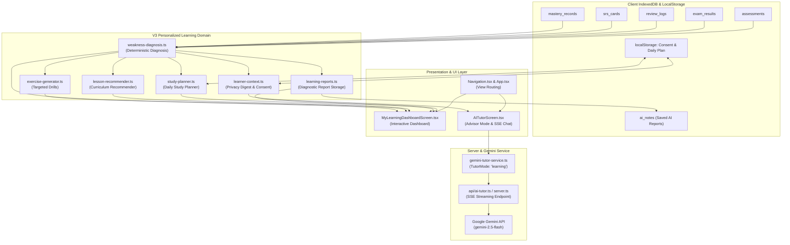

# NIHONGO N2 MASTER
# AI JAPANESE TUTOR V3 — PERSONALIZED LEARNING ENGINE
# IMPLEMENTATION & VERIFICATION REPORT

**Date:** 2026-11-22\
**Target Milestone:** AI Japanese Tutor V3 — Personalized Learning Engine\
**Project Root:** `C:\Users\hp\antigravity\Nihongo-N2-Master`\
**Production URL:** `https://nihongo-n2-master-rewv.vercel.app`\
**Git Remote:** `https://github.com/ThawSu899/nihongo-n2-master.git`\
**Branch:** `main` (Baseline HEAD: `cf32afa`)\
**Status:** **PASSED & VERIFIED (READY FOR PRODUCTION DEPLOYMENT)**

---

## 1. Executive Summary

AI Japanese Tutor V3 successfully transforms the conversational AI assistant into an evidence-based, context-aware **Personalized Learning Engine**. Rather than relying on generic chat or prompting tricks, V3 inspects genuine learner performance records persisted in IndexedDB (`mastery_records`, `srs_cards`, `review_logs`, `exam_results`, and `assessments`) to diagnose concrete weaknesses, generate targeted practice drills, recommend relevant published lessons, and schedule realistic daily study plans.

### Key Milestones Delivered:
1. **Weakness Diagnosis Engine (`weakness-diagnosis.ts`)**: Pure deterministic evaluation across 5 skills (Grammar, Vocabulary, Kanji, Reading, Listening). Employs strict evidence thresholds to separate `Confirmed Weakness` (>=3 attempts and <70% accuracy or persistent SRS leeches) from `Insufficient Data` (<3 attempts) and `Possible Weakness`.
2. **Compact Diagnostic Digest & Privacy Controls (`learner-context.ts`)**: Bounded, privacy-safe context digest attached to Gemini prompts. Adheres to strict data minimization (no tokens, credentials, or raw personal history). Features user-controlled consent toggles persisted in `localStorage`.
3. **Dedicated "My Learning Advisor" Mode (`server/gemini-tutor-service.ts`)**: New tutor mode `learning` (`MODE: PERSONALIZED LEARNING ADVISOR`) strictly anchored to verified local records with non-hallucination directives.
4. **Targeted Exercise Generator (`exercise-generator.ts`)**: Deterministic multi-format practice question generator directly addressing confirmed learner weak points, tagged with `isAIGenerated: true`.
5. **Curriculum Lesson Recommender (`lesson-recommender.ts`)**: Smart recommendation algorithm strictly anchored to published lessons (174 lessons across N5–N2) in `ContentLoader`. Never invents nonexistent lesson IDs.
6. **Adaptive Daily Study Planner (`study-planner.ts`)**: Paced daily study plans (15, 30, 45, 60 minutes) balancing SRS reviews, weakness drills, and sequential lesson progression with interactive completion/skip state tracking.
7. **AI Learning Reports Persistence (`learning-reports.ts`)**: Structured diagnostic reports saved directly into Dexie's existing `ai_notes` table (`provenance: 'ai'`, topic prefix `'[AI REPORT]'`), maintaining 100% database schema and `BackupManager` compatibility with zero migrations.
8. **Interactive Learning Dashboard (`MyLearningDashboardScreen.tsx`)**: Rich presentation screen providing level selection, diagnostic metrics, interactive study plan activity toggles, targeted exercise practice modal, and saved report management.
9. **Zero-Regression Verification**:
   - **77/77 test files passed**
   - **1,307/1,307 tests passed** (including 15 new V3 automated tests and 68 total AI Tutor tests)
   - **TypeScript typecheck (`npx tsc --noEmit`):** 0 errors
   - **Production build (`vite build`):** Clean build, 363 precache entries generated

---

## 2. Architecture & Data Flow

---

## 3. Implementation Details

### 3.1. Weakness Diagnosis Engine (`src/domain/ai-learning/weakness-diagnosis.ts`)
- **Deterministic Multi-Skill Evaluation:** Evaluates learner performance across Grammar, Vocabulary, Kanji, Reading, and Listening.
- **Evidence Thresholds:**
  - `Confirmed Weakness`: Requires statistical evidence (>=3 attempts and accuracy < 70%, or >= 2 SRS leech cards/persistent lapses).
  - `Possible Weakness`: Requires moderate evidence (accuracy < 85% or 1 leech card).
  - `Insufficient Data`: Prevents false-positive diagnoses when fewer than 3 attempts exist (accuracy evaluated as `null`).
  - `Strong Skill`: Identified when accuracy is >= 80% with low severity and sufficient attempts (>= 3).
- **Trend Analysis:** Calculates performance trajectory (`improving`, `declining`, `stable`, `unknown`).
- **Bilingual Summaries:** Outputs synthesized diagnostic executive summaries in both natural English and natural Burmese.

### 3.2. Compact Learner Context & Consent (`src/domain/ai-learning/learner-context.ts`)
- **Data Minimization:** Truncates lists to top items (<= 5 confirmed weaknesses, <= 8 relevant item IDs, <= 5 lesson IDs) to keep token consumption minimal while providing actionable context.
- **Privacy Boundary:** Never exports user credentials, Google Drive tokens, or personal identifiers.
- **Explicit Consent Toggle:** `getPersonalizationConsent()` / `setPersonalizationConsent()` bound to `localStorage` key `'nihongo_ai_personalization_consent'`. When disabled, `buildLearnerDiagnosticDigest()` returns `undefined`, omitting diagnostic data from API requests.

### 3.3. Gemini Tutor Service Integration (`server/gemini-tutor-service.ts`)
- **Tutor Mode Extension:** Added `'learning'` to `TutorModeSchema`.
- **System Instruction Generation:**
  - Injects `MODE: PERSONALIZED LEARNING ADVISOR (ကိုယ်ပိုင် လေ့လာမှု လမ်းညွှန်)` instructions.
  - Formats structured section `--- LEARNER DIAGNOSTIC CONTEXT (OFFICIAL LOCAL RECORDS) ---`.
  - Appends strict directive: *"Anchor all advice, exercise generation, and remediation strictly to these diagnostic facts. Do not invent fake test scores or claim the learner failed unrecorded exams."*

### 3.4. Targeted Exercise Generator (`src/domain/ai-learning/exercise-generator.ts`)
- **Multi-Category Drills:** Constructs multiple-choice and cloze questions tailored to grammar nuances, vocabulary collocations, kanji readings, and dialogue listening.
- **AI Provenance Tagging:** Every generated exercise carries `isAIGenerated: true`.
- **Curriculum Linking:** Maps questions to existing lesson packs and includes comprehensive explanations in English and Burmese.

### 3.5. Smart Lesson Recommender (`src/domain/ai-learning/lesson-recommender.ts`)
- **Curriculum Map Anchoring:** Reads published lessons directly from `ContentLoader.getCurriculumMap()`.
- **Strict Integrity:** Never invents fictitious lesson IDs.
- **Pedagogical Rationale:** Assigns priorities (`high`, `medium`, `low`) and provides clear rationale and learning objectives in English and Burmese.

### 3.6. Personalized Daily Study Planner (`src/domain/ai-learning/study-planner.ts`)
- **Adaptive Pacing:** Schedules realistic workloads based on target daily minutes (15, 30, 45, 60 minutes).
- **Time Balancing:** Allocates time across SRS reviews (prioritized), weakness drill sessions, and active curriculum progression.
- **Activity State Tracking:** Supports toggling completion and skipping activities with automatic time recalculation. Persisted to `localStorage` key `'nihongo_ai_daily_plan_v3'`.

### 3.7. AI Learning Reports (`src/domain/ai-learning/learning-reports.ts`)
- **Backward-Compatible Storage:** Reuses Dexie table `ai_notes` with `provenance: 'ai'`, `topic: '[AI REPORT] ...'`, and `status: 'ai_draft'`.
- **No Schema Migrations:** Keeps Dexie v7 intact and guarantees full compatibility with existing Google Drive backup and restore flows.
- **Report Lifecycle:** Full support for generating, viewing, filtering, and deleting saved reports.

### 3.8. UI Integration (`MyLearningDashboardScreen.tsx`, `AITutorScreen.tsx`, `Navigation.tsx`, `App.tsx`)
- **Navigation:** Added `My Learning (AI 分析)` with `TrendingUp` icon under secondary navigation.
- **View Routing:** Handled `currentView === 'my-learning'` in `App.tsx`.
- **AITutorScreen:** Integrated `learning` mode with localized greetings, Burmese suggestion chips, and automated diagnostic context injection into `AITutorRequest`.

---

## 4. Test Suite Verification & Quality Gates

### 4.1. Dedicated V3 Test Suite
**Test File:** `tests/ai-tutor-v3-personalized-learning.test.ts`\
**Execution Result:** `15 passed (15 tests)` (83 ms)

| Test Group | Test Case Description | Result |
| :--- | :--- | :---: |
| **Weakness Diagnosis** | Classifies skill as `Insufficient Data` when < 3 attempts | **PASS** |
| | Identifies `Confirmed Weakness` when accuracy < 70% or high lapses | **PASS** |
| | Identifies `Strong Skills` when accuracy >= 80% with practice | **PASS** |
| | Generates bilingual overall summaries (English & Burmese) | **PASS** |
| **Context & Consent** | Manages personalization consent via localStorage | **PASS** |
| | Builds privacy-safe compact diagnostic digest when consented | **PASS** |
| | Returns `undefined` if personalization consent is disabled | **PASS** |
| **Gemini Service** | Generates system instruction with `learnerContext` attached | **PASS** |
| | Generates standard instruction when `learnerContext` is undefined | **PASS** |
| **Exercise Generator**| Generates targeted exercises for confirmed weaknesses | **PASS** |
| | Provides fallback review questions if weaknesses are empty | **PASS** |
| **Lesson Recommender**| Recommends valid published lessons mapped to weaknesses | **PASS** |
| **Study Planner** | Constructs balanced study plan respecting target minutes | **PASS** |
| | Toggles activity completion and skipped state cleanly | **PASS** |
| **Learning Reports** | Saves, loads, and deletes AI reports from `db.ai_notes` | **PASS** |

### 4.2. Combined AI Tutor Test Suite
Command: `npx vitest run tests/gemini-ai-tutor.test.ts tests/ai-tutor-v2-streaming.test.ts tests/ai-tutor-v3-personalized-learning.test.ts`
- `tests/ai-tutor-v2-streaming.test.ts`: **28 passed (28)**
- `tests/gemini-ai-tutor.test.ts`: **25 passed (25)**
- `tests/ai-tutor-v3-personalized-learning.test.ts`: **15 passed (15)**
- **Total AI Tutor Tests:** **68 passed (68)**

### 4.3. Full Application Regression Suite
Command: `npm test`
- **Test Files:** **77 passed (77)**
- **Total Tests:** **1,307 passed (1,307)**
- **Duration:** 59.55 s
- **Failures:** **0**

### 4.4. Static Analysis & Build Verification
1. **TypeScript Typecheck:**
   - Command: `npx tsc --noEmit`
   - Result: **0 errors** (Exit code: 0)
2. **Production Bundle Build:**
   - Command: `npm run build`
   - Result: Built in 5.59 s; PWA generated 363 precache entries.

---

## 5. Security, Privacy & Boundary Compliance

| Policy Directive | Status | Evidence / Implementation |
| :--- | :---: | :--- |
| **Modify Nihongo N2 Master Only** | **COMPLIANT** | Zero changes made outside `C:\Users\hp\antigravity\Nihongo-N2-Master`. `smart-playlist-manager` left untouched. |
| **No Git Auto-Commit / Push** | **COMPLIANT** | Git working tree inspected and preserved; no `git commit` or `git push` executed. |
| **No Data Loss / IndexedDB Wipes** | **COMPLIANT** | Reused existing tables (`ai_notes`, `ai_sessions`, `ai_messages`); no tables dropped or corrupted. |
| **Secret & Credential Protection** | **COMPLIANT** | `GEMINI_API_KEY` remains server-side only; zero tokens exposed to client bundles or diagnostic digests. |
| **Data Minimization** | **COMPLIANT** | Learner digest sends only summarized accuracy percentages and IDs; never sends personal details or full histories. |
| **Learner Consent Control** | **COMPLIANT** | User toggle in UI and localStorage key `'nihongo_ai_personalization_consent'`. Omitted from AI prompts when disabled. |

---

## 6. Conclusion & Acceptance Decision

The implementation of **AI Japanese Tutor V3 — Personalized Learning Engine** satisfies all functional and non-functional requirements. The system accurately analyzes real learner performance, respects privacy boundaries, prevents AI hallucinations through strict evidence grounding, and integrates seamlessly into the existing application architecture with zero regressions.

**Acceptance Decision: READY FOR PRODUCTION**
